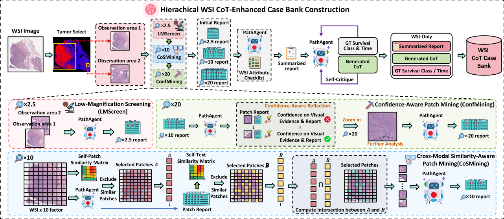
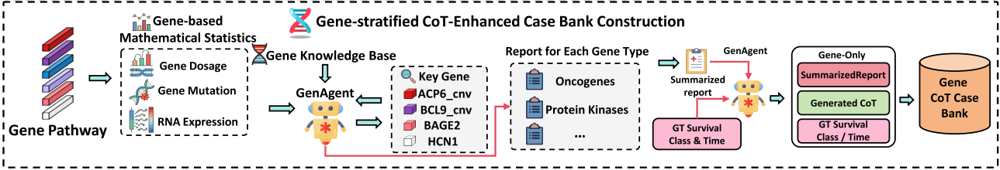
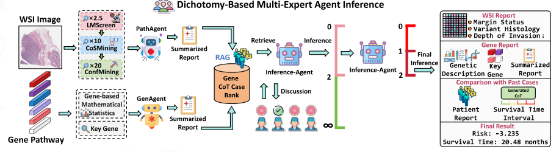

<div align="center">

# SurvAgent

### Hierarchical CoT-Enhanced Case Banking and Dichotomy-Based Multi-Agent System for Multimodal Survival Prediction

**ACM Multimedia 2026**

[Paper · ACM Digital Library](https://dl.acm.org/doi/10.1145/3767308.3835399) · [GitHub](https://github.com/hotdogisme/SurvAgent)

</div>

## Environment setup

Use Python 3.10 or newer. Run the commands from the SurvAgent folder. [OpenSlide installation](https://openslide.org/api/python/#installing)

```bash
python -m pip install openslide-bin openslide-python
python -m pip install Pillow numpy scipy scikit-learn
python -m survagent --help
```

SurvAgent connects to a chat service and an embedding service using OpenAI-compatible endpoints. The table shows the models used in the paper. Set each model ID to the name exposed by your service.

| Role | Model used in the paper | Used for |
| --- | --- | --- |
| Text | Qwen2.5-32B-Instruct | WSI report synthesis, genomic analysis, and survival inference |
| Vision | PathGen-LLaVA | Writing descriptions of WSI patches |
| Embedding | text-embedding-3-large | Comparing descriptions and retrieving similar cases |

```bash
export SURVAGENT_BASE_URL="http://127.0.0.1:8000/v1"
export SURVAGENT_MODEL="your-text-model-id"
export SURVAGENT_VISION_MODEL="your-vision-model-id"
export SURVAGENT_EMBEDDING_BASE_URL="http://127.0.0.1:8001/v1"
export SURVAGENT_EMBEDDING_MODEL="your-embedding-model-id"
```

The text and vision models share `SURVAGENT_BASE_URL`. Set `SURVAGENT_API_KEY` for that service and `SURVAGENT_EMBEDDING_API_KEY` for the embedding service if they require authentication. Use the same embedding model when building and querying a case bank.

Install the optional dependencies for the inputs you use.

```bash
python -m pip install h5py               # CLAM coordinate files
python -m pip install torch torchvision   # CTransPath patch features
```

CTransPath also needs the modified timm 0.5.4 distributed by CHIEF. Precomputed patch features can also be supplied. [CLAM](https://github.com/mahmoodlab/CLAM) · [CHIEF](https://github.com/hms-dbmi/CHIEF)

The release includes framework code, inference code, and prompts. Bring your own data, checkpoints, historical cases, and expert estimates.

## 1. Hierarchical WSI CoT-Enhanced Case Bank



PathAgent generates descriptions at three magnifications. **LMScreen (2.5×)** captures the tissue overview. **CoSMining (10×)** keeps patches that pass both visual and text similarity filtering. **ConfMining (20×)** revisits regions that need more detail. The descriptions are merged into one WSI report. For historical cases, `build-bank` uses that report and the risk category derived from the observed survival time to generate WSI-only CoT.

Start with a `wsi.json` that has a `slide` path. Set `objective_power` to the scanner magnification when the slide lacks it. Input file paths are relative to the JSON file. Pass `wsi.json` directly to `report-wsi`, or export the tiles first to inspect them.

```bash
python -m survagent tile-wsi --input /path/to/wsi.json --export-tiles outputs/tiles --output outputs/wsi_manifest.json
python -m survagent report-wsi --input outputs/wsi_manifest.json --output outputs/wsi_report.json
```

- `tile-wsi` exports a 2.5× overview and 10×, 512-pixel tiles. Add `--screening` for 20×, 256-pixel screening patches. `max_screening_patches` sets a limit for that export.
- Supply `clam_coords` as a CLAM HDF5 file with a `coords` dataset and `chief_attention` as a NumPy array in the same order to select regions using CHIEF attention and DBSCAN. The defaults are an attention threshold of `0.6` after min–max normalization, `min_samples=10`, and up to 128 candidate regions. With a slide alone, candidate regions come from the tissue grid.
- For visual similarity, supply each tile's `embedding` or configure `chief_encoder` with `module` (CHIEF's `models/ctran.py`), `checkpoint` (CTransPath weights), and optionally `device`. This also supplies features for newly generated 20× patches.
- For pre-cut patches, supply `overview` and a `regions` array with `image`, `embedding`, and optional 20× `detail` tiles. When the raw slide is present, `bounds` accepts level-0 coordinates `[x, y, width, height]`. Set `checklist` to `bladder` to use the archived bladder-cancer attribute list.

The release defaults to a 2.5× overview of the whole slide. The figure illustrates the paper's observation-area workflow and CoT self-critique step. The release uses the original CoT generation prompt in its case-bank builder. [WSI tiling](survagent/wsi.py) · [PathAgent](survagent/path_agent.py) · [WSI prompts](survagent/prompts/wsi)

## 2. Gene-stratified CoT-Enhanced Case Bank



GenAgent groups copy-number variation, mutation, and RNA-seq measurements into six gene classes. It computes group statistics, looks up the measurements of genes mentioned during initial analysis, and merges the group reports into a single genomic report. When building the historical bank, the genomic report also goes through the original gene-only CoT prompt.

For a wide measurement table, set `case_id`, `measurements_csv`, and `signatures_csv` in `genes.json`. The measurement table has one row per case and uses `GENE_cnv`, `GENE_rnaseq`, and `GENE_mut` or a bare gene column for mutations. The signature table groups genes under **Tumor Suppressor Genes**, **Oncogenes**, **Protein Kinases**, **Cell Differentiation Markers**, **Transcription Factors**, and **Cytokines and Growth Factors**.

```bash
python -m survagent prepare-genes --input /path/to/genes.json --output outputs/grouped_genes.json
python -m survagent report-genes --input outputs/grouped_genes.json --output outputs/gene_report.json
```

The report command can also take `genes.json` directly, or a JSON document with a `groups` object containing numeric `cnv`, `mutation`, and `rna_seq` values. Use binary mutation values and zero-centered expression values when the sign represents upregulation or downregulation. Pass gene annotations in `annotations` or `annotations_json` to provide gene knowledge, and use `patient_information` for optional context. The output includes group statistics and selected measurements in `group_analysis`.

The case-bank builder stores the gene report, gene-only CoT, and observed survival time alongside the WSI and joint fields. [Gene input](survagent/gene_input.py) · [GenAgent](survagent/gen_agent.py) · [Genomic prompts](survagent/prompts/genomics) · [CoT prompts](survagent/prompts/cot)

## 3. Dichotomy-Based Multi-Expert Agent Inference



SurvAgent embeds the current WSI and gene reports together to retrieve the three most similar historical cases by cosine similarity. It then uses the archived four-bin prompt to combine the current reports, historical cases, and precomputed expert estimates. A second prompt estimates the survival time in months using the selected interval and historical evidence.

Build the case bank once from historical cases. `historical_reports.json` is an array of records with `case_id`, `wsi_report`, `gene_report`, and observed `survival_months`. The builder generates WSI-only, gene-only, and joint CoT and embeds the paired reports. Retrieval excludes the current case ID.

| Field in `patient.json` | Meaning |
| --- | --- |
| `case_id` | Identifier shared by the request and any case-specific gene input |
| `wsi_manifest` or `wsi_report` | Path to a WSI input JSON or an existing pathology report |
| `gene_input` or `gene_report` | Path to a gene input JSON or an existing genomic report |
| `experts` | Expert names mapped to survival estimates in months or intervals. `[36, null]` means over 36 months. |

```bash
python -m survagent build-bank --input /path/to/historical_reports.json --output outputs/case_bank.json
python -m survagent predict --case /path/to/patient.json --bank outputs/case_bank.json --output outputs/prediction.json
```

To review the interval decision before estimating the exact time, run `analyze` and pass its result to `predict`.

```bash
python -m survagent analyze --case /path/to/patient.json --bank outputs/case_bank.json --output outputs/analysis.json
python -m survagent predict --case outputs/analysis.json --bank outputs/case_bank.json --output outputs/prediction.json
```

The output includes the selected survival interval, predicted months, rationale, and retrieved case IDs. The four intervals are 0–12, 12–24, 24–36, and over 36 months. Expert models supply their estimates as inputs to the interval stage. [Case bank](survagent/case_bank.py) · [Fusion](survagent/fusion.py) · [Inference](survagent/inference.py) · [Inference prompts](survagent/prompts/inference)

### Citation

```bibtex
@inproceedings{huang2026survagent,
  title     = {SurvAgent: Hierarchical CoT-Enhanced Case Banking and
               Dichotomy-Based Multi-Agent System for Multimodal Survival Prediction},
  author    = {Huang, Guolin and Chen, Wenting and Yang, Jiaqi and Lyu, Xinheng
               and Luo, Xiaoling and Yang, Sen and Xing, Xiaohan and Shen, Linlin},
  booktitle = {Proceedings of the 34th ACM International Conference on Multimedia},
  series    = {MM '26},
  year      = {2026},
  publisher = {Association for Computing Machinery},
  doi       = {10.1145/3767308.3835399},
  url       = {https://doi.org/10.1145/3767308.3835399}
}
```
